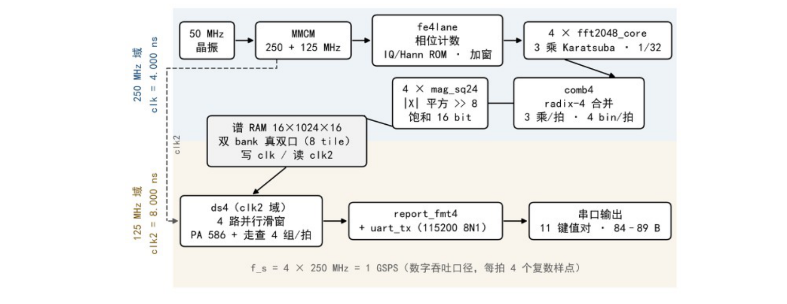

# 1 GSPS 数字吞吐 · 8192 点实时频谱分析电路

**4 lane × 2048-pt FFT → output-side radix-4 merge → 8192-pt spectrum, on a single Artix-7 XC7A35T.**
A complete RTL implementation of a real-time spectrum analyser for digital baseband IQ:
8192-point transform at 1 GSPS digital throughput (4 lanes × 250 MHz, four complex samples
per clock), 8.192 µs per frame, spectrum-to-result latency ≤ 17.1 µs, and 85 of the device's
90 DSP48E1 slices consumed. The stimulus is an on-chip ROM replay — **there is no 1 GSPS ADC
on the board**, and every number in this document states its evidence level (L1 derivation,
L2 implementation report, L3 behavioural simulation, L4 board measurement).

> 竞赛作品归档，非活跃项目。核心结论：在只有 90 个 DSP48E1 的 XC7A35T 上，靠位精确的
> 3 乘法 Karatsuba 把 4 路并行的乘法预算从 105 压到 85，使 1 GSPS 数字吞吐成为可能。
> 代码与报告按原样公开，便于复核；不承诺维护。



---

## 徽章


-orange)
-orange)


-blue)


---

## 这是什么 / 不是什么

| | |
|---|---|
| **是** | 一个可综合、可复现的 8192 点流水线频谱分析电路：频点、带宽、幅度、帧长四类结果经 UART 上报 |
| **是** | 一份带证据等级的指标记录：每个数字都能追到实现报告的某一行或报告的某一节（见 [`docs/metrics.md`](docs/metrics.md)） |
| **不是** | 一个接收机。板上没有高速 ADC、没有模拟前端，激励是片内 ROM 回放，**没有系统级闭环** |
| **不是** | 一个通用 FFT IP。点数、lane 数、缩放都是为本设计硬编码的，换点数要改结构 |

---

## 指标

证据等级：**L1** 结构推导 · **L2** 实现报告（Vivado 时序/资源报告）· **L3** 行为级仿真对拍 · **L4** 板级实测。

| 指标 | 值 | 证据等级 | 出处 |
|---|---|---|---|
| 数字吞吐 | **1 GSPS**（4 lane × 250 MHz，每拍 4 个复数样点；板上无 1 GSPS ADC） | L1+L2+L3+L4 | 报告 §1.2 表 1-1 |
| IQ 位宽 | 12 bit | L3+L4 | 报告 §3.4 表 3-6 |
| FFT 点数 | 8192 = 4 × 2048，输出侧 radix-4 合并 | L1+L3 | 报告 §4.3 |
| 频率分辨率 | 122.070 kHz（= 1 GSPS / 8192） | L1+L3 | 报告 §5.3.1 式 (5-2) |
| DSP48E1 | **85 / 90（94.44%）** | L1+L2 | `08_DOC` 资源报告；逐模块分配见报告表 4-1 |
| Block RAM | **41 / 50（82.00%）**（RAMB36 等效：27 个 RAMB36 + 28 个 RAMB18 = 27 + 14） | L2 | 同上 |
| LUT / FF | 12819（61.63%）/ 21320（51.25%） | L2 | 同上 |
| WNS | clk1 250 MHz **+0.351 ns**；clk2 125 MHz **+0.197 ns**（全设计最紧） | L2 | 报告 §4.6 表 4-7 |
| 失败端点 | **0 / 69227** | L2 | 同上 |
| 帧长 / 更新周期 | 8.192 µs（1024 个 clk2 = 2048 个 clk1） | L1+L3+L4 | 报告 §3.5 表 3-7 |
| 分析处理时间 | **≤ 17.1 µs**（结构上界 2132 个 clk2）；报文 LAT 实测 2128 拍 = 17.024 µs | L1+L3+L4 | 报告 §3.5、§5.4 表 5-4 |
| 数字 IQ 带宽 | **768.55 MHz**（6296 bin × 122.07 kHz，板测；可测边界 0.80–0.86 GHz） | L1+L3+L4 | 报告 §5.3.3、表 5-2 |
| 3 乘法 Karatsuba | 单核 **20 → 15** 个 DSP，全链 105 → 85 | L1+L2 | 报告 §4.2 |
| 定点对拍 | 单音 8192/8192 逐 bin 相同；宽带最大差 ±6 LSB | L3 | 报告 §5.5；入口 `sim/cmp_all.py` |

> 口径说明：1 GSPS 是**数字吞吐**，不是采样率；768.55 MHz 是**板测 −3 dB 读数**，不是器件能不能跑到的上限；
> 仿真一律标 L3，不称"实测"。

---

## 架构三处要点

**1 · 位精确的 3 乘法 Karatsuba。** 4 乘法复乘每核 20 个 DSP，4 核加前级共 105 个，超过器件的 90 个——
4 路并行在写 RTL 之前就不成立。改成 3 乘法后每核 15 个、全链 85 个。关键在于**位精确**：中间信号加宽到
43/44 bit、移位前不截断，截断点与 4 乘法版同位同舍入，因此换了乘法结构、结果逐位不变（2992 组向量 0 差异）。

**2 · 输出侧 radix-4 合并。** 4 个核各给一路 2048 点谱，它们按对 4 取模分属四个同余类、不是连续四段，
所以要合并成 8192 点必须在合并处再乘旋转因子。输出侧 radix-4 只对 Z1、Z2、Z3 乘旋转因子，蝶形只剩加减与
(-j) 旋转：每拍 3 个复乘、出 4 个 bin，合并级 9 个 DSP 而不是 12 个。

**3 · 250 / 125 MHz 两域，跨域只跨真双口 RAM。** 采集、变换、合并、平方在 250 MHz；平滑、双引擎走查、
报文格式在 125 MHz。两域之间只跨一个谱 RAM 的双口和单比特帧标志——真双口 BRAM 的独立时钟端口天然隔离，
不需要握手或异步 FIFO。下游用连续捕获 + PA/PB 双引擎：pass A 固定 586 拍、pass B 最坏 517 拍，都落在一帧
1024 拍预算内，故稳态每帧出一组结果（N=1）。

---

## 设计空间：为什么不是 2 lane

上一代是 **600 MSPS、2 lane × 4096 点、用 Xilinx FFT IP** 的实现，板级 WNS +0.119 ns。它到不了 1 GSPS
的原因不是时序而是乘法：2 lane 要继续提速率就得加倍并行度，DSP 与加法器同时不够。决策表、三列预算与
"2 lane 在 600 MSPS 触顶"的论证见 [`docs/design-evolution.md`](docs/design-evolution.md)。

那一代代码不随本仓库发布（其 FFT IP 的 HDL 是许可受限产物，不可再分发）。

---

## 目录

```
.
├── README.md
├── LICENSE                 CC BY-NC-SA 2.0（官方全文）
├── NOTICE                  第三方归属 / AI 声明 / 口径声明
├── CITATION.cff
├── docs/
│   ├── architecture.md     数据流、时钟域、模块职责、位宽链
│   ├── metrics.md          每个数字 → 出处（报告节号 / .rpt 行）
│   ├── reproduce.md        三步复现 + 六个坑
│   ├── design-evolution.md 600M/2lane → 1G/4lane 决策表
│   ├── waveform-guide.md   怎么看仿真波形
│   └── design-report.pdf   设计报告 64 页（中文，竞赛提交版）
├── rtl/                    本设计 12 个源文件（10 个参与综合 + 2 个备查）
├── third_party/fftcore/    第三方 FFT 核 15 个 VHDL + 原 LICENSE + 原 README
├── gen/                    2048 点结构与旋转因子表（10 个 VHDL）
├── ip/clk_wiz_0.xci        MMCM：50 MHz → 250 / 125 MHz
├── constrs/board_4lane.xdc 引脚、时钟、Flash 配置位、报文 FSM 多周期
├── sim/                    tb_sys4.v、5 个 ROM 初值 .mem、定点模型、对拍脚本
└── scripts/
    ├── build_project.tcl   建工程到 _proj/，不污染仓库根
    ├── run_synth.tcl       综合并核对 8-4445 与 DSP 数（复现判据）
    ├── open_check.tcl      只清点不综合（源码/IP/约束是否齐）
    ├── run_sim_wave.tcl    跑仿真并一次把 14 个信号放进波形窗
    ├── _pre_copy_mem.tcl   综合前把 .mem 拷进 run 目录的钩子
    └── wave_demo.wcfg      波形配置
```

---

## 三步复现

```bash
# 0. 纯英文路径下克隆（Vivado 2020.2 对中文路径不友好，会在 MMCM IP 阶段中断）
git clone https://github.com/JackRONG225/fft-spectrum-1gsps.git
cd fft-spectrum-1gsps

# 1. 建工程（Vivado 2020.2）——产物在 _proj/，仓库根保持干净
vivado -mode batch -source scripts/build_project.tcl
#    末行应为 ### BUILD_PROJ_DONE

# 2. 综合并核对——这一步才是"能不能复现"的判据
vivado -mode batch -source scripts/run_synth.tcl
#    末行应为 ### SYNTH_CHECK_DONE，其中两行必须正好是：
#      ### SYNTH_84445_COUNT 0    ROM 全部找到，没有静默全零
#      ### SYNTH_DSP         85    与交付网表一致

# 3. 跑仿真看波形（在 Vivado Tcl Console 里，不用命令行）
#    source {<repo>/scripts/run_sim_wave.tcl}
#    期望末态 TB_END ndone=8 nwv=20714 nwr=12292 nfend=11 assert_fail=0
#             LAT cyc=2128 ns=17024
```

> `rtl/` 里 5 个 `$readmemh` 用相对文件名（`iq4.mem` 等），不含任何绝对路径：
> 综合时 `scripts/_pre_copy_mem.tcl` 钩子把 `sim/*.mem` 拷进综合 run 目录，
> 仿真时 `scripts/run_sim_wave.tcl` 拷进 xsim 目录。这条链断掉的后果是**静默**的——
> 综合照常完成、比特流照常生成、谱全零。判据见坑 ①。

六个会让复现"静默失败"的坑（ROM 全 0、串口乱码、`-R` 截断波形等）逐条写在
[`docs/reproduce.md`](docs/reproduce.md)。

---

## 已知限制

1. **板上无真实模拟前端、无高速 ADC**，激励为片内 ROM 回放，**没有系统级闭环**。
2. 只做了**行为级仿真**（xsim behavioural），**未做综合后仿真、未做实现后时序仿真**。
3. **未做 ILA 在线抓取**；板级证据是串口报文 + 上板照片。1G 档资源与时序都不允许插 ILA 核。
4. 引脚约束只对正点原子达芬奇 XC7A35T-FGG484 有效，换板需改 `constrs/board_4lane.xdc` 的 4 行引脚与 1 行时钟周期。
5. 12 bit IQ 与 1 GSPS 均为**数字域**指标，与模拟输入性能无关；可测带宽 0.80–0.86 GHz 的判据是定点模型与 RTL 能否互证，不是器件上限。
6. 跨 Vivado 版本未验证；长时间老化未做（板级只有 60 s 量级连续抓包）。

---

## Authors

| 作者 | 贡献 |
|---|---|
| **容培钧** | 架构设计、RTL 编写、仿真验证、时序优化、板级测试 |
| **管书玮** | 系统测试协助、文档整理与排版 |

2026 年安徽省集成电路精英赛，赛道 2（FPGA 设计及应用）。

---

## AI Disclosure

部分 RTL、设计报告与测试脚本在 AI 辅助下完成。**所有数字均由作者自己的仿真与上板运行产生，
并逐条可追溯**（`docs/metrics.md` 给出每个数字的出处）。AI 未被用于生成任何性能结论。
详见 [NOTICE](NOTICE)。

---

## Acknowledgements

We appreciate the Supercomputing Center of USTC for providing high-performance AI infrastructure services.

---

## License

本仓库整体以 **[CC BY-NC-SA 2.0](https://creativecommons.org/licenses/by-nc-sa/2.0/)**（Creative Commons
Attribution-NonCommercial-ShareAlike 2.0 Generic）发布，**禁止商业使用**。全文见 [LICENSE](LICENSE)。

必须诚实说明的一点：**CC BY-NC-SA 2.0 不是 OSI 认可的开源许可证。** 准确说法是
**source-available / 非商业源码开放**——源码可读、可改、可再分发，但不得商用，且衍生作品须同许可。
本仓库之所以采用该许可，是因为它包含第三方 FFT 核（CC BY-NC-SA 2.0），ShareAlike 条款要求整体同许可。

---

## Citation

仓库根目录的 [`CITATION.cff`](CITATION.cff) 可被 GitHub 直接识别。引用格式：

```bibtex
@misc{rong2026fft1gsps,
  author       = {Rong, Peijun and Guan, Shuwei},
  title        = {1 GSPS Digital-Throughput 8192-point Real-Time Spectrum Analyser on Artix-7},
  year         = {2026},
  howpublished = {\url{https://github.com/JackRONG225/fft-spectrum-1gsps}},
  note         = {2026 Anhui Province Integrated Circuit Elite Competition, Track 2}
}
```

完整设计报告（64 页，中文）就在 [`docs/design-report.pdf`](docs/design-report.pdf)，随仓库发布；
比特流 `duty100_1G_250MHz.bit` 与 `.mcs` 在 Release 附件里。报告中每个结论的证据等级与本节指标表一一对应。
